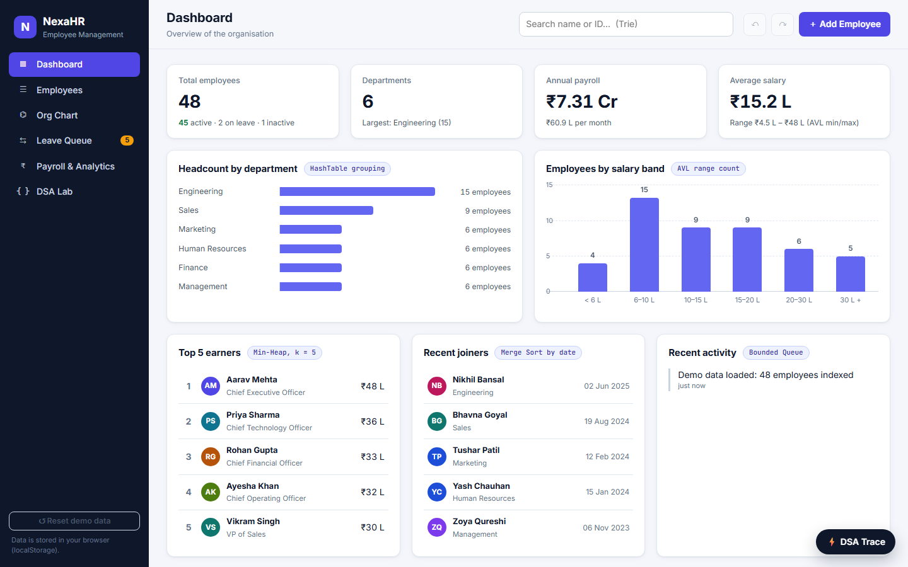
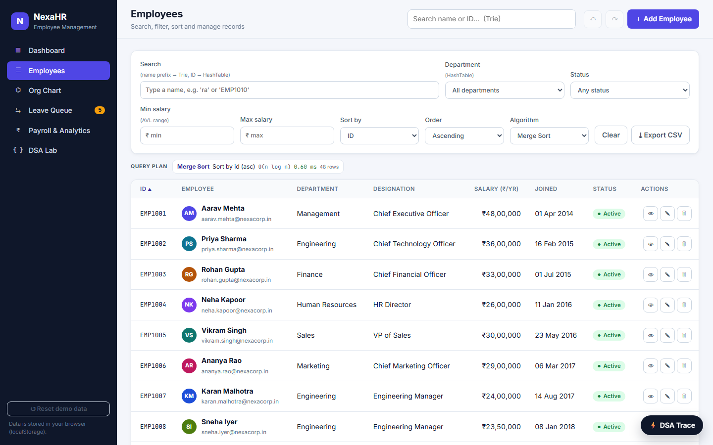
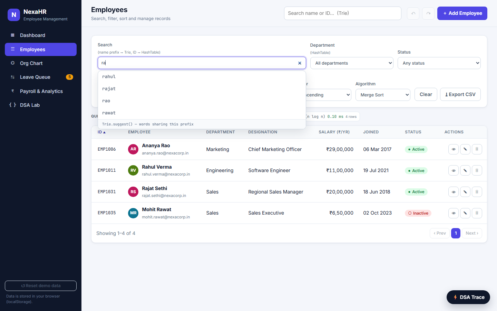
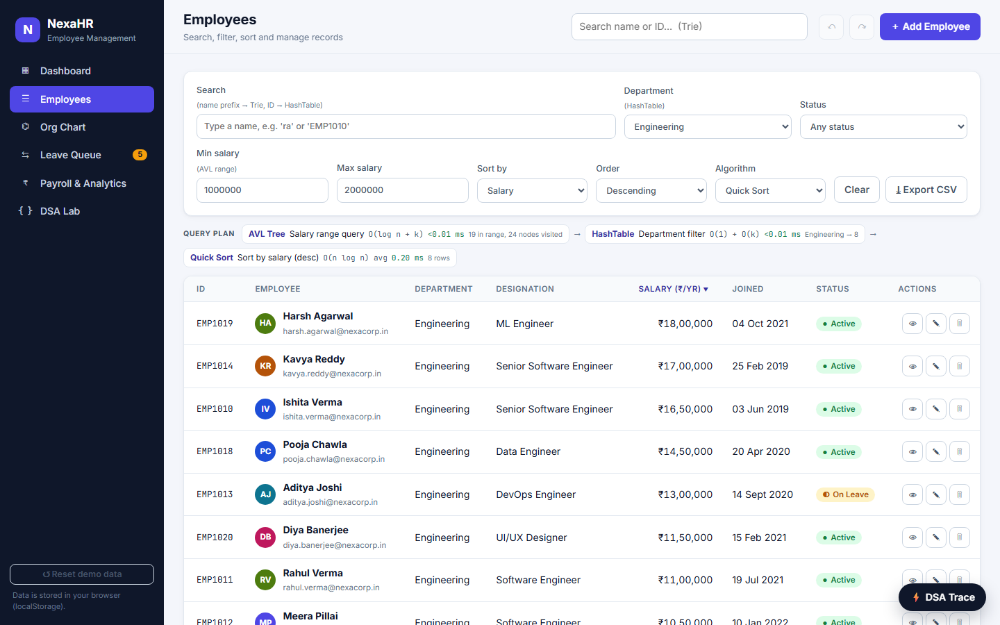
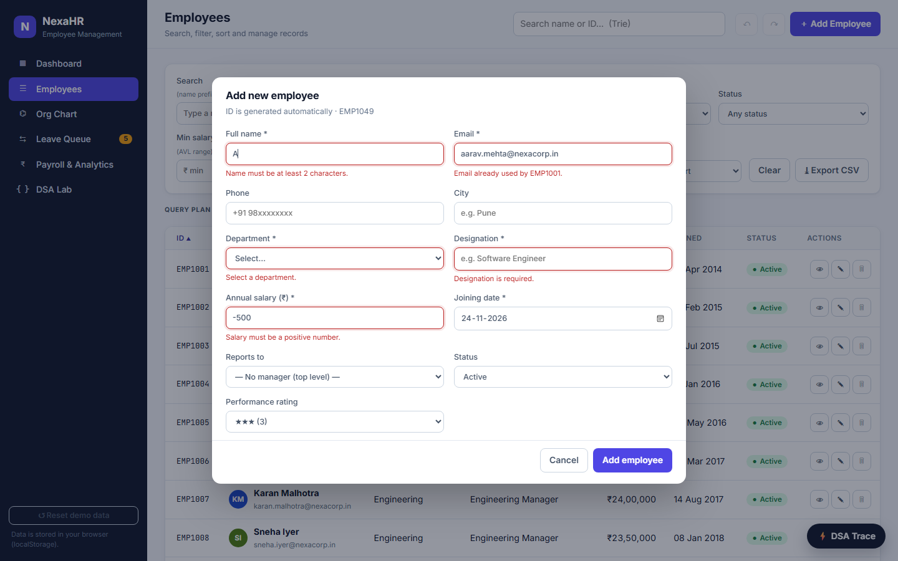
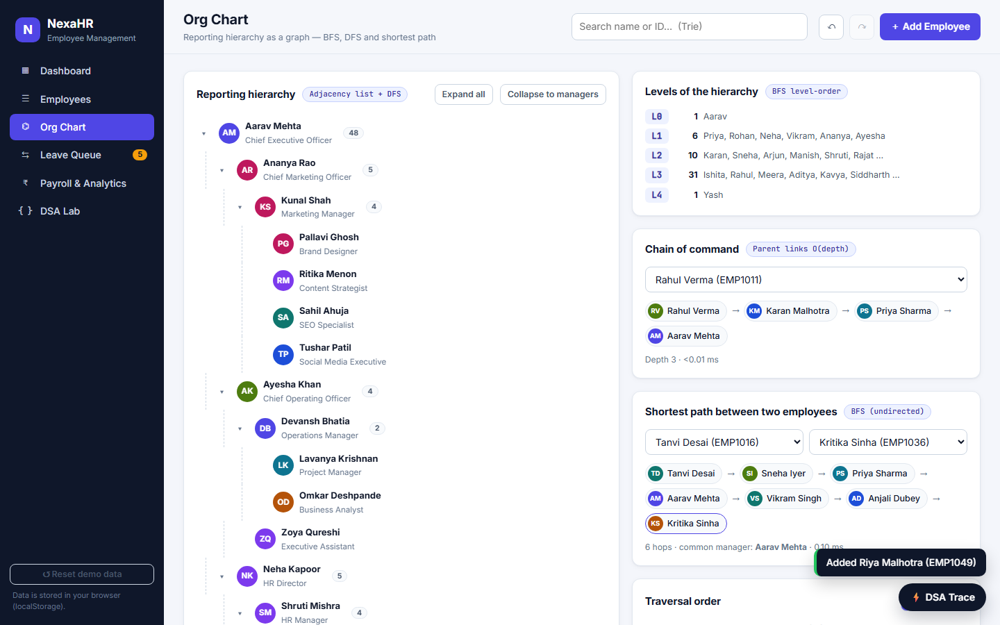
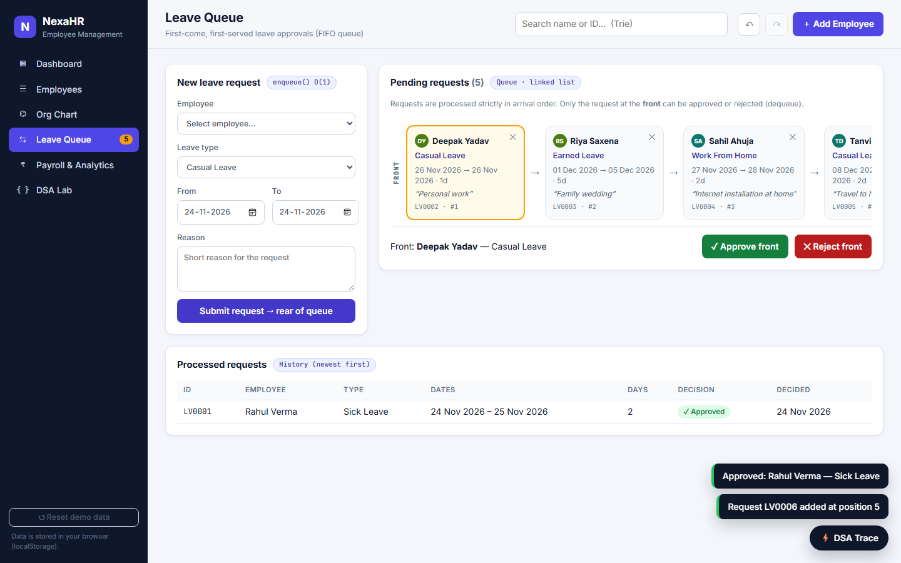
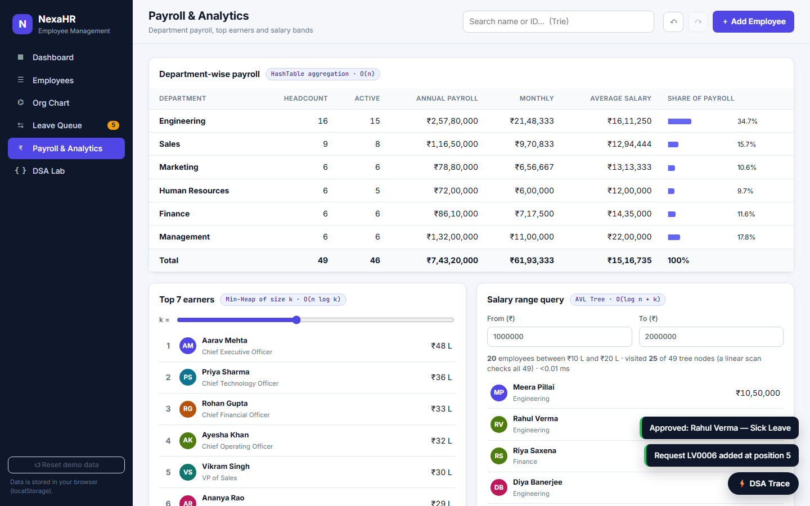
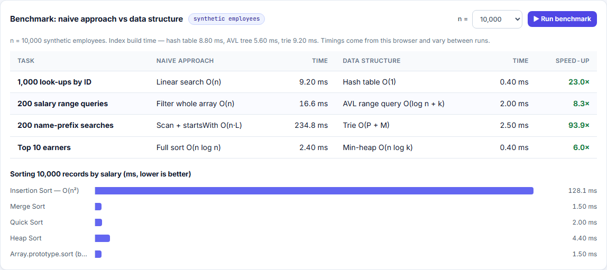

# NexaHR — Employee Management System (DSA Project)

A complete Employee Management System whose every feature is powered by a **hand-written data structure or algorithm** — no frameworks, no libraries, no build step. All data structures live in [`js/dsa/`](js/dsa) and are covered by automated tests.

**Live demo:** https://nexahr-employee-management.vercel.app  
**Source:** https://github.com/vaasuchhabra/employee-management-system



---

## Features

| Module | What it does | Data structure / algorithm |
|---|---|---|
| **Dashboard** | Headcount, payroll, average salary, department chart, salary bands, top earners, recent joiners, activity feed | Hash Table, AVL Tree, Min-Heap, Merge Sort, Bounded Queue |
| **Employees** | Add / edit / delete with validation, live search with autocomplete, filter by department, status and salary range, sort by any column with a choice of algorithm, pagination, CSV export | Hash Table, Trie, AVL Tree, Merge / Quick / Heap Sort |
| **Undo / Redo** | Every add, edit and delete can be undone (Ctrl + Z) and redone (Ctrl + Y) | Two Stacks |
| **Employee profile** | Details, chain of command up to the CEO, direct reports, team size, leave history | Hash Table, Graph |
| **Org Chart** | Collapsible hierarchy, BFS levels, BFS / DFS order, shortest path between two employees, lowest common manager, cycle prevention | Graph (adjacency list), BFS, DFS |
| **Leave Queue** | Leave requests processed first-come-first-served; approve / reject the front, cancel any | Queue (linked list) |
| **Payroll & Analytics** | Department-wise payroll, adjustable Top-K earners, salary range query, salary band chart | Hash Table, Min-Heap, AVL Tree |
| **DSA Lab** | Live view inside the hash table buckets, AVL tree, trie, heap and stacks, plus a benchmark of naive vs DSA approaches on up to 1,00,000 records | All of the above |
| **DSA Trace** | A floating console that lists which data structure answered every operation, its complexity and the time it took | — |

## Data structures and complexity

| Structure | File | Used for | Time complexity |
|---|---|---|---|
| Hash Table (separate chaining, auto-resize) | [`HashTable.js`](js/dsa/HashTable.js) | ID lookup, unique e-mail, department groups | O(1) average |
| AVL Tree (self-balancing BST) | [`AVLTree.js`](js/dsa/AVLTree.js) | Salary index, range queries, min / max | O(log n), range O(log n + k) |
| Trie (prefix tree) | [`Trie.js`](js/dsa/Trie.js) | Name search and autocomplete | O(L) per word |
| Binary Heap | [`Heap.js`](js/dsa/Heap.js) | Top-K earners, Heap Sort | O(log n), Top-K O(n log k) |
| Queue (singly linked list) | [`Queue.js`](js/dsa/Queue.js) | Leave requests, activity log | O(1) enqueue / dequeue |
| Stack | [`Stack.js`](js/dsa/Stack.js) | Undo / Redo | O(1) push / pop |
| Graph (adjacency list) | [`OrgGraph.js`](js/dsa/OrgGraph.js) | Org chart, BFS, DFS, shortest path, cycle check | O(V + E) |
| Merge, Quick, Heap, Insertion Sort; Binary Search | [`sorting.js`](js/dsa/sorting.js) | Sorting the employee table, benchmarks | O(n log n); O(log n) |

## Screenshots

| | |
|---|---|
|  |  |
|  |  |
|  |  |
|  |  |

## Python version (console)

The same data structures are also implemented in **Python** in [`python/`](python), with a menu-driven console Employee Management System:

```bash
cd python
python ems.py            # interactive menu (data saved to employees.json)
python ems.py --demo     # runs every feature once and prints the results
python -m unittest test_ems.py -v   # 12 tests
```

| File | Contents |
|---|---|
| [`python/dsa.py`](python/dsa.py) | HashTable, AVLTree, Trie, Heap, Queue, Stack, OrgGraph, merge / quick / heap / insertion sort, binary search |
| [`python/ems.py`](python/ems.py) | `EmployeeStore` (CRUD, validation, undo/redo, leave queue) and the console menu |
| [`python/test_ems.py`](python/test_ems.py) | Unit tests for every structure and the store |

## Project structure

```
├── index.html              App shell (sidebar, top bar, trace panel)
├── css/style.css           All styling, responsive down to 360 px
├── js/
│   ├── app.js              Hash router, global search, undo/redo, trace panel
│   ├── store.js            EmployeeStore — combines every data structure, validation, persistence
│   ├── seed.js             48 demo employees, leave requests, synthetic data generator
│   ├── ui.js               DOM helpers, modal, toast, bar charts
│   ├── dsa/                ← the data structures (no dependencies)
│   └── views/              One file per page
├── tests/dsa.test.js       29 automated tests (node:test)
└── python/                 Console version of the same system in Python
```

## Run locally

No installation needed — it is plain HTML, CSS and JavaScript (ES modules).

```bash
git clone https://github.com/vaasuchhabra/employee-management-system.git
cd employee-management-system
npm start          # serves on http://localhost:5173
npm test           # runs the 29 unit + integration tests
```

Any static server works (`npx serve .`, VS Code Live Server, …). Opening `index.html` directly from the file system does not work because browsers block ES modules on `file://`.

## Deploy

The project is a static site, so Vercel deploys it with zero configuration: import the GitHub repository in Vercel, keep the framework preset as **Other**, and click **Deploy**.

## Tech stack

HTML5 · CSS3 · JavaScript (ES2022 modules) · Node.js test runner · Vercel. Data is saved in the browser's `localStorage`; **Reset demo data** in the sidebar restores the original 48 employees.
